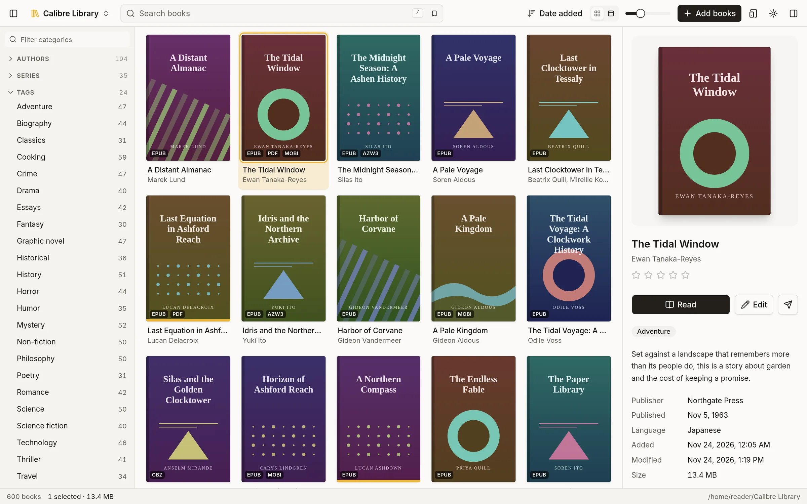
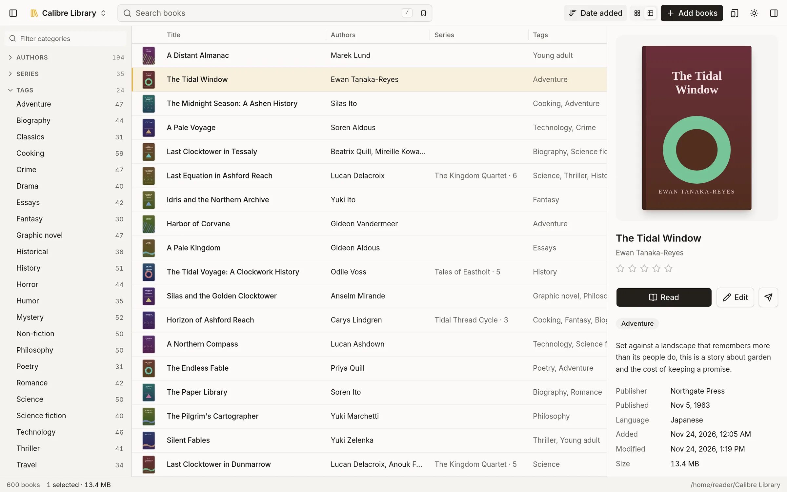
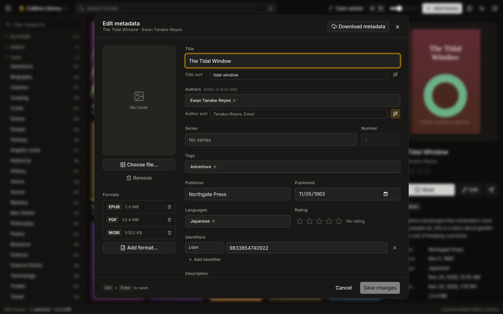
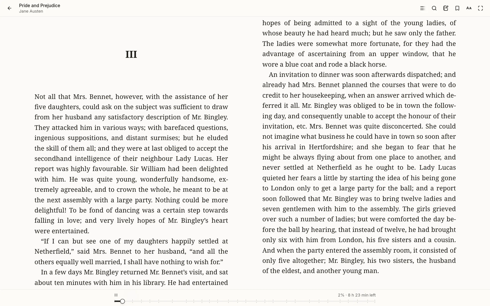
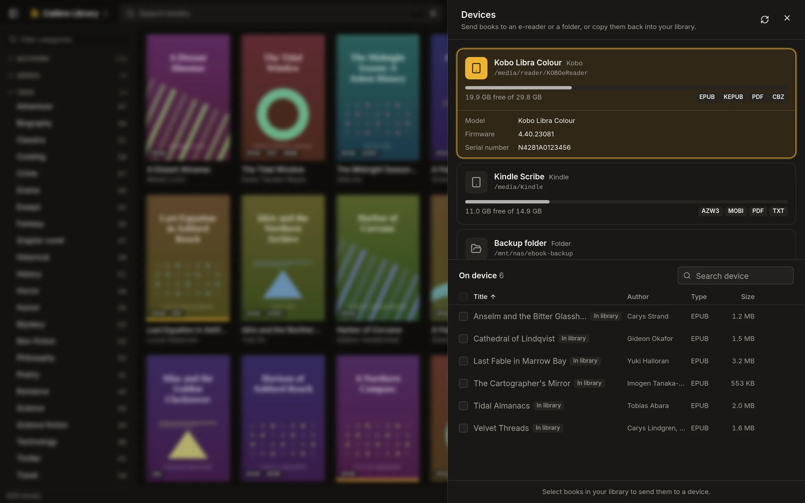

<div align="center">


# Shelfmark

**A fast, modern ebook library manager that opens your calibre library in place.**

[](https://github.com/OrellBuehler/shelfmark/releases)
[](LICENSE)


[Website](https://orellbuehler.github.io/shelfmark/) · [Download](https://github.com/OrellBuehler/shelfmark/releases) · [Report a bug](https://github.com/OrellBuehler/shelfmark/issues)

<picture>
  <source media="(prefers-color-scheme: dark)" srcset="docs/screenshots/library-dark.webp">
  
</picture>

</div>

## Why Shelfmark

Shelfmark reads and writes calibre's `metadata.db` and folder layout directly. There is nothing to import or migrate: point it at the library you already have, and keep using calibre next to it whenever you like.

Reading positions, highlights and notes are stored in a separate `shelfmark.db` next to `metadata.db`, so calibre's own data stays as calibre expects it.

## Features

| | |
|---|---|
| **Library** | Cover grid and table view, calibre search syntax (`tags:fantasy and rating:>=4`), browser for authors, series, tags, publishers, languages and formats, saved searches |
| **Metadata** | Edit one book or many at once, read embedded metadata from EPUB and PDF, download metadata and covers from Open Library and Google Books |
| **Reader** | EPUB, MOBI, AZW3, FB2, CBZ and PDF with highlights, notes, bookmarks, in-book search and light, sepia and dark themes |
| **Devices** | Send books to Kobo, Kindle, PocketBook and Tolino readers over USB or to any folder, convert EPUB to AZW3 for Kindle, copy books from a device back into the library |

<table>
  <tr>
    <td width="50%"></td>
    <td width="50%"></td>
  </tr>
  <tr>
    <td width="50%"></td>
    <td width="50%"></td>
  </tr>
</table>

### Keyboard

| Key | Action |
|---|---|
| <kbd>/</kbd> or <kbd>Ctrl</kbd>+<kbd>F</kbd> | Search |
| <kbd>Enter</kbd> | Read the selected book |
| <kbd>E</kbd> | Edit metadata |
| <kbd>I</kbd> | Toggle the details panel |
| <kbd>Ctrl</kbd>+<kbd>B</kbd> | Toggle the sidebar |
| <kbd>Ctrl</kbd>+<kbd>A</kbd> | Select all |
| <kbd>Delete</kbd> | Delete the selected books |

## Install

Installers for Windows, macOS and Linux, plus a portable Windows build, are attached to each [release](https://github.com/OrellBuehler/shelfmark/releases).

To use Google Books as a metadata source, set `SHELFMARK_GOOGLE_BOOKS_KEY` to your API key.

## Development

You need Rust, [Bun](https://bun.sh) and the [Tauri prerequisites](https://tauri.app/start/prerequisites/) for your platform.

```sh
bun install
bun run tauri dev
```

```sh
bun run check
cargo test --workspace
bun run tauri build
```

`bun run dev` runs the interface in a browser against an in-memory mock library, no Rust build required.

## Layout

| Path | Contents |
|---|---|
| `crates/model` | Shared types |
| `crates/library` | calibre database access and search |
| `crates/formats` | Ebook metadata, covers and online sources |
| `crates/devices` | E-reader detection and transfer |
| `crates/reading` | Reading positions and annotations |
| `src-tauri` | Desktop shell and commands |
| `src` | Svelte interface |
| `docs` | Website |

## License

GPL-3.0-or-later. The library crate embeds calibre's database schema. Shelfmark is not affiliated with calibre.
